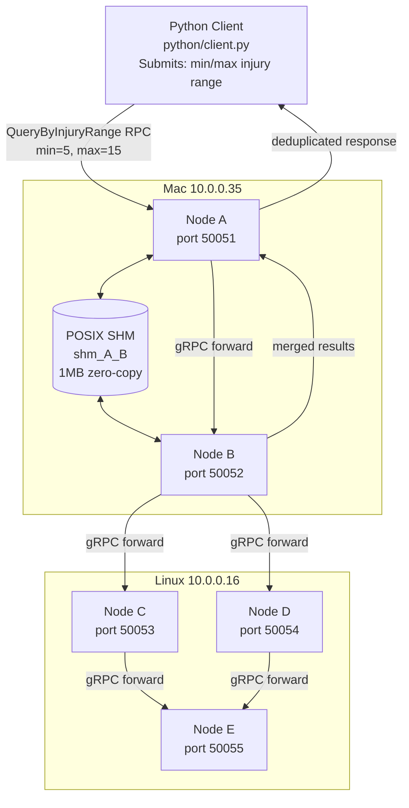

<div align="center">

# Distributed Overlay Query Router

**Multi-machine distributed query engine with overlay routing, shared-memory IPC, and flood-controlled query propagation over gRPC**

[](https://isocpp.org/)
[](https://grpc.io/)
[](https://protobuf.dev/)
[](https://man7.org/linux/man-pages/man7/shm_overview.7.html)
[](https://python.org/)

*5-node overlay across 2 machines · fan-out async routing · dedup query control · zero-copy SHM cache · result merging*

</div>

---

## Impact at a Glance

- **2-Machine Deployment** — macOS (10.0.0.35) + Linux (10.0.0.16)
- **Overlay Flood Routing** — Fan-out via std::async, visited-set dedup
- **Zero-Copy SHM Cache** — POSIX shm_open + mmap between co-located nodes
- **Async Fan-out** — std::async parallel neighbor queries
- **Result Deduplication** — record_id dedup across merged responses
- **Graph Topology Config** — JSON-driven node/edge overlay definition
- **400K Records / Node** — NYC collision CSV loaded per node
- **C++17 + gRPC** — ~840 lines across 4 source files

---

## Architecture



---

## Core Components

| Component | File | Responsibility |
|-----------|------|----------------|
| **Node** | `src/node.cc` / `node.h` | gRPC servicer, query routing, SHM cache, fan-out, dedup |
| **DataManager** | `src/data_manager.cc` / `data_manager.h` | CSV load (up to 400K records), injury range filter |
| **ShmUtils** | `src/shm_utils.cc` / `shm_utils.h` | `shm_open` + `mmap`  1MB POSIX shared memory segment |
| **Proto** | `proto/basecamp.proto` | `QueryService.QueryByInjuryRange` RPC definition |
| **Config** | `config/overlay.json` | Node IDs, host/port, edge topology |
| **Python Client** | `python/client.py` | Submits queries, displays results | ---

## How It Works

### 1. Overlay Topology (JSON-Driven)

Nodes and edges are defined in `config/overlay.json`:

```json
{
  "nodes": [
    { "id": "A", "host": "10.0.0.35", "port": 50051 },
    { "id": "B", "host": "10.0.0.35", "port": 50052 },
    { "id": "C", "host": "10.0.0.16", "port": 50053 },
    { "id": "D", "host": "10.0.0.16", "port": 50054 },
    { "id": "E", "host": "10.0.0.16", "port": 50055 }
  ],
  "edges": [["A","B"], ["B","C"], ["B","D"], ["C","E"], ["D","E"]]
}
```

Each node creates gRPC stubs for its neighbors on startup and identifies **local edges** (same host) for shared memory.

### 2. Zero-Copy Shared Memory Cache

Co-located nodes on the same host share a POSIX SHM segment instead of making an RPC:

```cpp
// Naming: smaller_id + "_" + larger_id  consistent across both nodes
std::string name = (nbr.id < id_) ? ("shm_"+nbr.id+"_"+id_) : ("shm_"+id_+"_"+nbr.id);
ShmCache* ptr = (ShmCache*) openOrCreateShm(name, 1024*1024);  // 1MB
```

```cpp
struct ShmCache {
    std::atomic<bool> ready;   // write barrier
    char   query_id[64];       // which query result is cached
    size_t data_size;
    unsigned char data[1024*1024];  // serialized QueryResponse protobuf
};
```

When a local neighbor already processed the query  read directly from SHM, zero RPC overhead.

### 3. Flood Routing with Deduplication

```
Client  Node A: QueryByInjuryRange(min=5, max=15)
  1. Check SHM cache  miss
  2. Check processedQueries set  not seen
  3. Mark query processed
  4. Run local filter (DataManager.filterByInjuryRange)
  5. fan-out: for each unvisited neighbor
        check SHM (same host)  hit: skip RPC, use SHM result
        std::async  QueryByInjuryRange RPC to neighbor
  6. Gather all futures (f.get())
  7. Merge + deduplicate by record_id
  8. Write result to SHM cache
  9. Return merged response
```

### 4. Result Deduplication

Each node tracks `seen_record_ids` when merging neighbor results:

```cpp
for (auto& rr : neighborResponse.records()) {
    if (seen_record_ids.find(rr.record_id()) != seen_record_ids.end())
        continue;  // skip duplicate
    seen_record_ids.insert(rr.record_id());
    combined.add_records()->CopyFrom(rr);
}
```

Prevents duplicate records from appearing when multiple routing paths converge (e.g., BCE and BDE both return E's records).

---

## gRPC Service

```protobuf
message QueryRequest {
    string query_id  = 1;   // unique ID for dedup/caching
    int32  min_injury = 2;
    int32  max_injury = 3;
    string sender_id  = 4;  // skip-back prevention
}

message QueryResponse {
    repeated Record records = 1;
}

service QueryService {
    rpc QueryByInjuryRange(QueryRequest) returns (QueryResponse);
}
```

---

## Build and Run

### Prerequisites

```bash
CMake 3.14+  | C++17 compiler  | gRPC + Protocol Buffers  | nlohmann/json  | Python 3 + grpcio
```

### Build

```bash
cd scripts && ./build_proto.sh   # generate gRPC stubs
mkdir -p build && cd build
cmake .. && make
```

### Start cluster

**Mac (10.0.0.35):**
```bash
./build/basecamp_node A config/overlay.json
./build/basecamp_node B config/overlay.json
```

**Linux (10.0.0.16):**
```bash
./build/basecamp_node C config/overlay.json
./build/basecamp_node D config/overlay.json
./build/basecamp_node E config/overlay.json
```

### Submit query

```bash
cd python
python client.py 10.0.0.35:50051 5 15
# Queries Node A: return all records with 515 injuries
```

---

## Tech Stack

| Layer | Technology |
|-------|-----------|
|  | C++17  `std::async`, `std::future`, RAII |
|  | gRPC  synchronous + async stubs |
|  | Protocol Buffers v3 |
|  | `shm_open` + `mmap`  1MB shared memory per local edge |
|  | JSON topology config for nodes + edges |
|  | grpcio query client | ---

## Design Decisions & Trade-offs

| Decision | Why | Known Limitation |
|----------|-----|-----------------|
| Flood routing (not DHT) | Simple overlay routing without central coordinator | O(edges) messages per query  not scalable to large clusters |
| POSIX SHM for local edges | Zero-copy result passing between co-located nodes  eliminates RPC round-trip | SHM holds only the latest query result; concurrent queries would need separate segments |
| `processedQueries` global set | Prevents redundant local computation on query revisit | Static set  grows unbounded, no TTL eviction |
| `std::async` fan-out | Parallel neighbor RPCs, non-blocking wait | Thread-per-neighbor  no pool, unbounded under high concurrency |
| `record_id` dedup on merge | Prevents duplicates when multiple paths reach same node | Requires globally unique record IDs across all nodes | ---

<div align="center">

**Built with C++17 · gRPC · Protocol Buffers · POSIX Shared Memory**

*Distributed Systems · Overlay Networks · IPC · Query Routing · Fault Tolerance*

</div>
